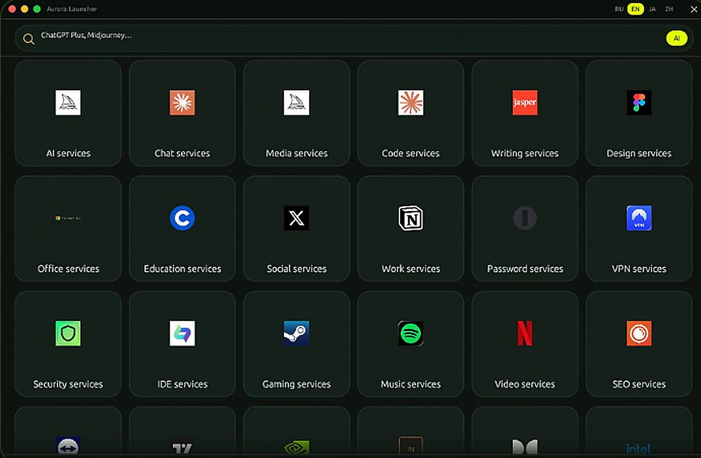

# pCloud Premium Free 2026 — 2 TB, Rewind, Crypto Folder

> **pCloud is paid everywhere. In our Aivora launcher the same paid Premium version is free.**
>
> Official site / app store = paid Premium subscription. Aivora launcher = that paid Premium product, free on Windows 10 / 11.

**Keywords:** pCloud Premium · pCloud free · pCloud windows · 2TB · Rewind · paid pCloud free through launcher · Aivora Programs

Windows 10 / 11 · pCloud Premium · Office and cloud

The orange button opens [https://aivoraprograms.com/](https://aivoraprograms.com/). Install Aivora, then **Activate** **pCloud**. You get the **paid Premium** product **for free in our launcher**. No `pCloud.exe` in this repository.

## What pCloud is

pCloud Premium is the paid cloud SKU: **2 TB**, **file versioning**, **Rewind up to 30 days**, Crypto Folder add-on, media player, password links. The Aivora card is **Premium**, not free 10 GB pCloud. This is not Dropbox Business and not iCloud+.

**pCloud is paid everywhere else.** Official access is a Premium subscription. In **our Aivora launcher** that same paid Premium is **free** on Windows 10 / 11. No vendor account. No credit card.

## 2 TB, Rewind, Crypto Folder

Rewind is the undelete extra. Crypto Folder is the encrypted extra. After **Activate**, open pCloud from Office and cloud. This repo has no file dump.

## Who this Windows page is for

Searches **pCloud Premium**, **pCloud windows**, **pCloud free** wanting **paid Premium**.

## What the Premium card includes

| Feature | Official pCloud | In our Aivora launcher |
|---------|--------------|------------------------|
| Price | Paid Premium subscription | **Free** (same paid Premium) |
| **2 TB storage** | Premium | Same paid Premium, free here |
| **Rewind (30 days)** | Premium | Same paid Premium, free here |
| **Crypto Folder add-on** | Premium | Same paid Premium, free here |

## How to open paid pCloud on Windows

1. Open [https://aivoraprograms.com/](https://aivoraprograms.com/)
2. Download **Aivora Launcher**
3. Install on **Windows 10** or **Windows 11** (64-bit)
4. Open **Office and cloud**
5. Find **pCloud** and press **Activate**

Paid pCloud Premium — **free in our launcher**, paid on the official site.

## Search queries this page covers

- **pCloud Premium**
- **pCloud free**
- **pCloud windows**
- **Rewind**
- **paid pCloud free through launcher**

## Screenshots

Aivora launcher hub — **Office and cloud** → **pCloud**:

## FAQ

**Is this Dropbox?**  
No. Dropbox Business is a different Aivora card. This tile is pCloud Premium.

**Where is the download?**  
[https://aivoraprograms.com/](https://aivoraprograms.com/)

**Is pCloud paid or free?**  
Paid everywhere (official Premium). **Free in our Aivora launcher** — same paid Premium version.

**Do I need a pCloud account?**  
No. **Activate** on the tile.

---

## На русском

# pCloud Premium бесплатно 2026 — 2 ТБ, Rewind, Crypto Folder

> **Везде pCloud платный. В нашем лаунчере Aivora та же платная версия Premium — бесплатно.**
>
> Официальный сайт / магазин = платная подписка Premium. Лаунчер Aivora = этот же платный Premium, бесплатно на Windows 10 / 11.

**Ключевые слова:** pCloud Premium · pCloud бесплатно · pCloud windows · 2ТБ · Rewind · платный pCloud бесплатно через лаунчер · Aivora Programs

Оранжевая кнопка — главная Aivora. Лаунчер → **Офис и облако** → **pCloud** → **Активировать**. Это **платный Premium**, у нас в лаунчере **бесплатно**.

pCloud Premium — платное облако: **2 ТБ**, **версии файлов**, **Rewind до 30 дней**, Crypto Folder, плеер, ссылки с паролем. Карточка Aivora — **Premium**, не free 10 ГБ. Это не Dropbox и не iCloud+.

**pCloud везде платный.** Официально подписка Premium. **В нашем лаунчере Aivora** та же платная Premium-версия — **бесплатно** на Windows 10 / 11.

Rewind — откат. Crypto Folder — шифрование. Дампа файлов в git нет.

Запросы **pCloud Premium**, **pCloud бесплатно** — нужен **платный Premium**.

| Функция | Официально | В нашем лаунчере Aivora |
|---------|------------|-------------------------|
| Цена | Платная подписка Premium | **Бесплатно** (тот же Premium) |
| **2 ТБ хранилище** | Premium | Та же платная Premium, у нас бесплатно |
| **Rewind (30 дней)** | Premium | Та же платная Premium, у нас бесплатно |
| **Crypto Folder** | Premium | Та же платная Premium, у нас бесплатно |

Как открыть: [https://aivoraprograms.com/](https://aivoraprograms.com/) → лаунчер → **Офис и облако** → **pCloud** → **Активировать**.

**Это Dropbox?**  
Нет. Dropbox — другая карточка. Здесь pCloud Premium.

pCloud — товарный знак pCloud AG. Страница описывает доступ через Aivora Programs.

[https://aivoraprograms.com](https://aivoraprograms.com/) · hello@aivora.app

#windows11 #windows10 #pcloud #cloud #aivora

---

*pCloud Premium · pCloud free · pCloud windows · 2TB · Rewind · paid pCloud free through launcher · Aivora Programs · paid pCloud free through launcher · Aivora Programs · https://aivoraprograms.com/programs/pcloud-premium/*
